# Certified construction gallery

Every displayed packing has passed the exact checker. These are local feasibility acceptances, not external record acceptances. [Record table](../RECORDS.md).

## N=100 — r=0.051401071774379

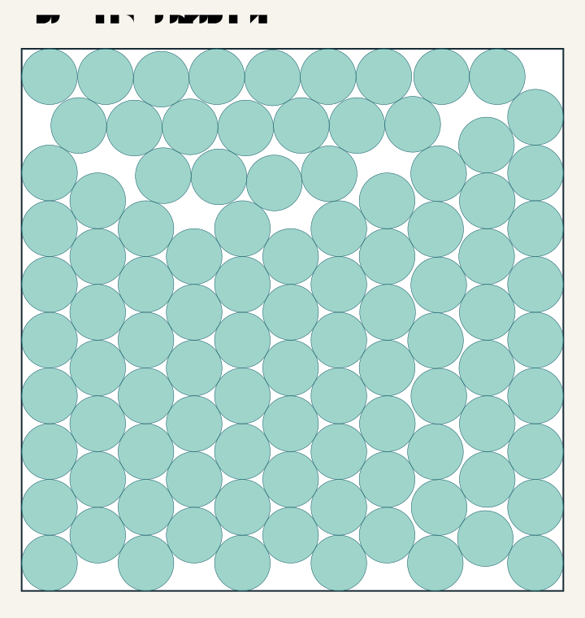

## N=106 — r=0.050015200426096

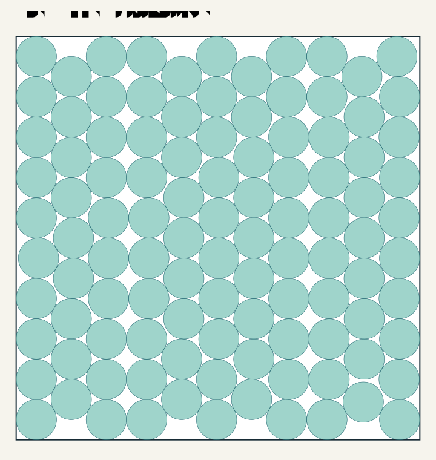

## N=134 — r=0.044564244207095

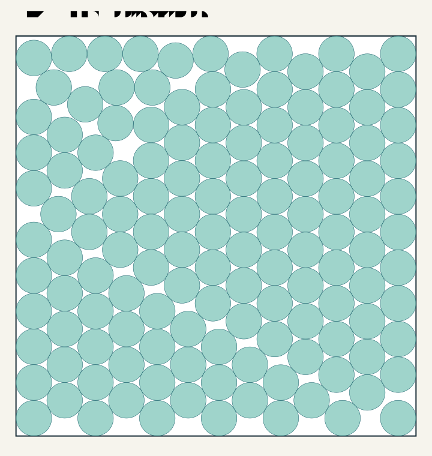

## N=150 — r=0.042145465901232

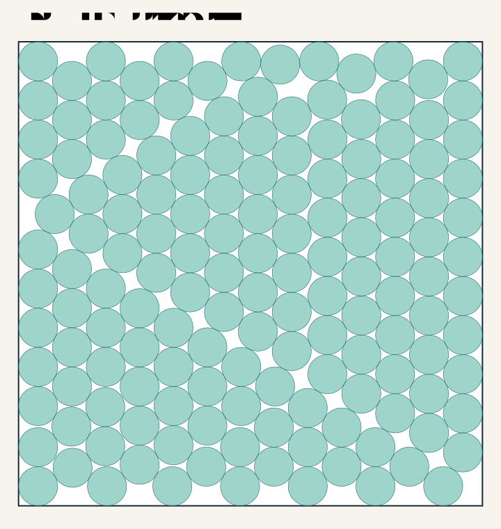

## N=200 — r=0.03661279890382

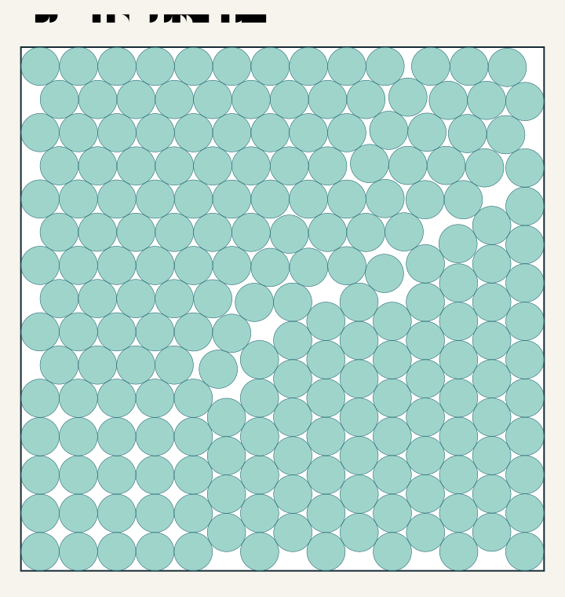

## N=250 — r=0.032879800209483

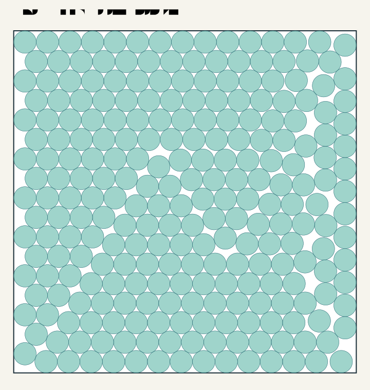

## N=300 — r=0.030219555704457

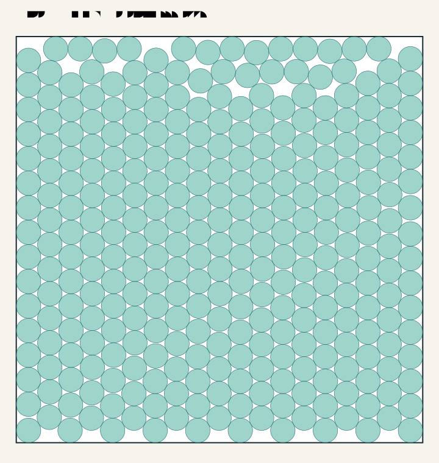

## N=400 — r=0.026202507076218

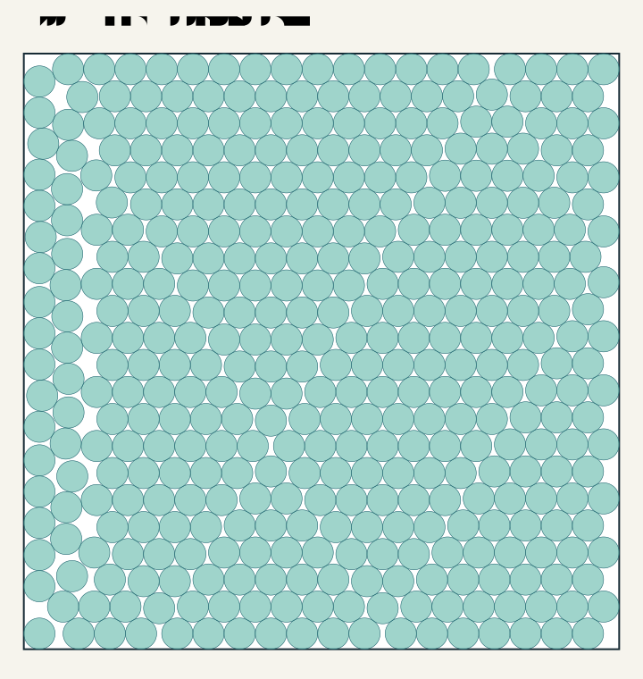

## N=500 — r=0.0234554989935

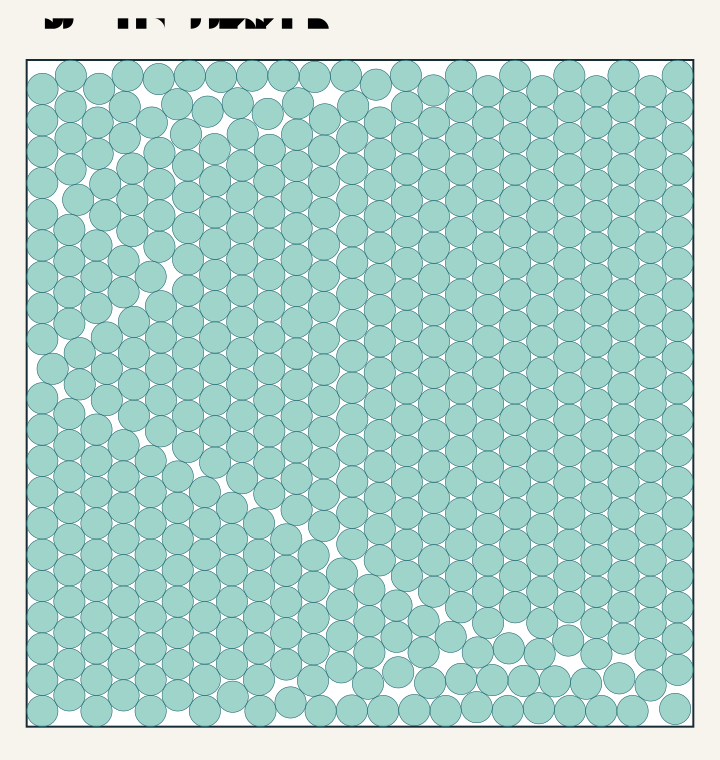

## N=600 — r=0.021479896578172

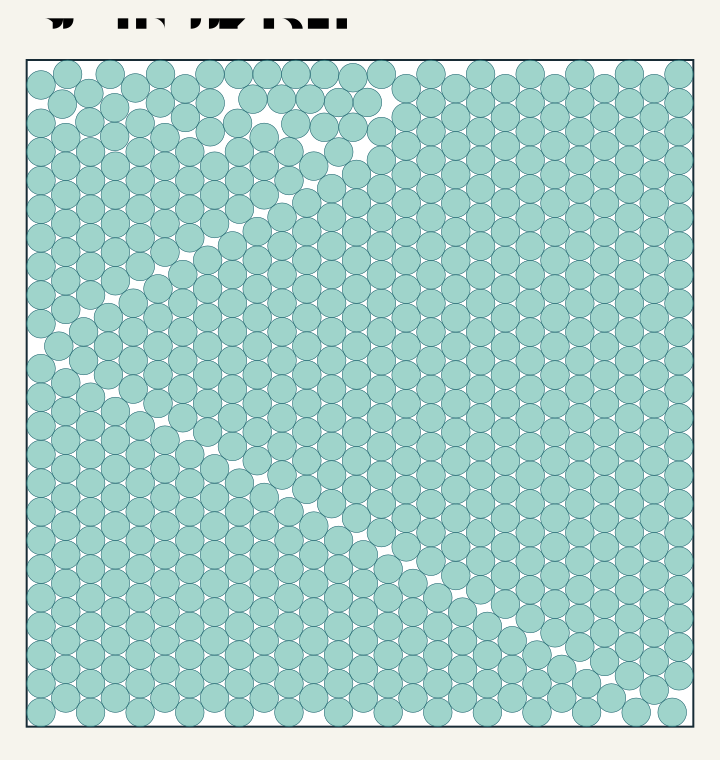

## N=700 — r=0.019903696933565

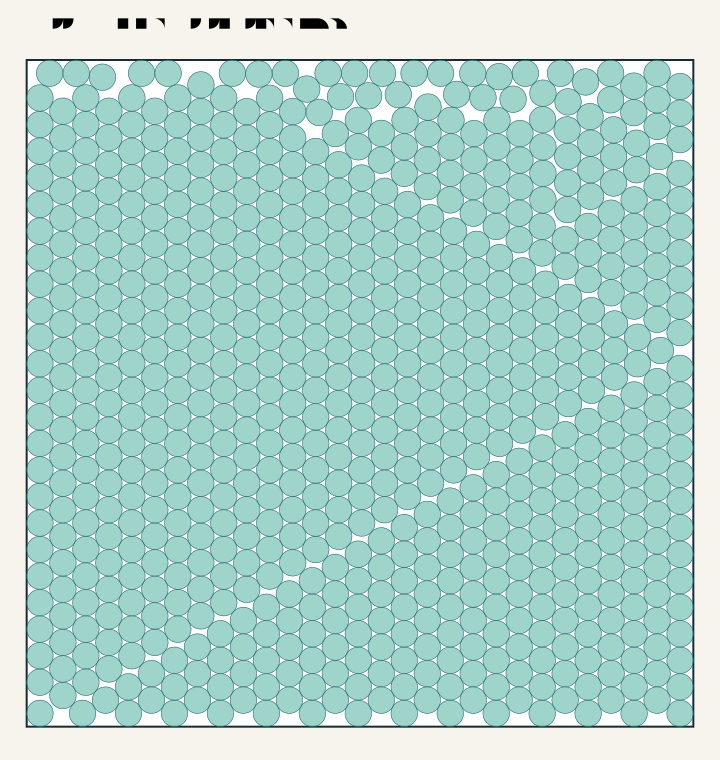

## N=800 — r=0.01863759228589

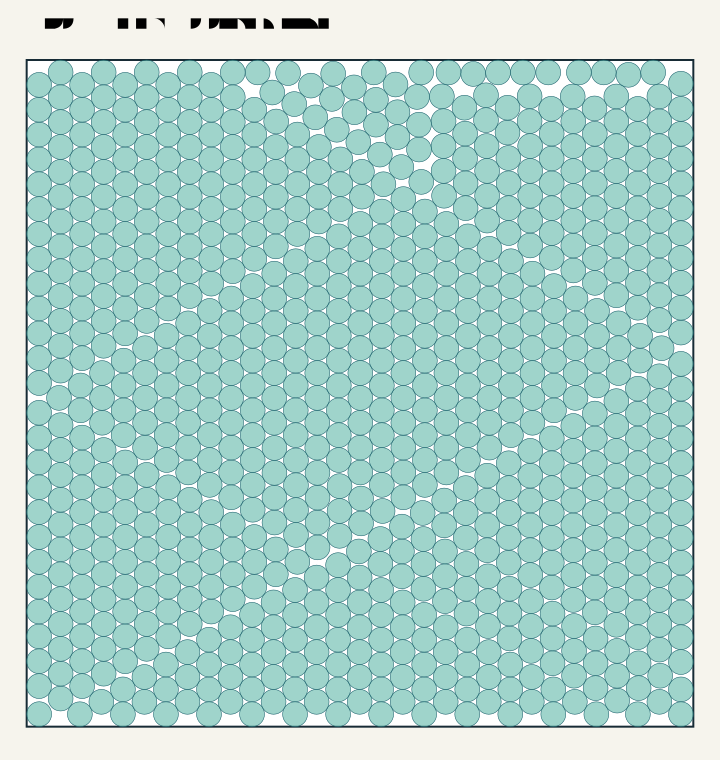

Baseline and neighbor SVGs are under `baseline/`; the independently rechecked N=47 AI control is under `external/`. Every stage winner also has an SVG in its experiment directory. Other trial witnesses are archived candidates, not accepted frontier constructions.
